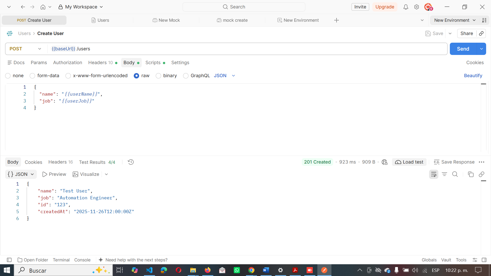
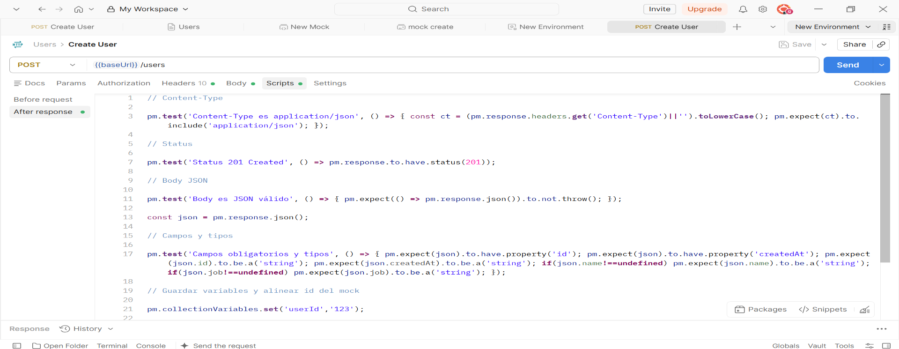
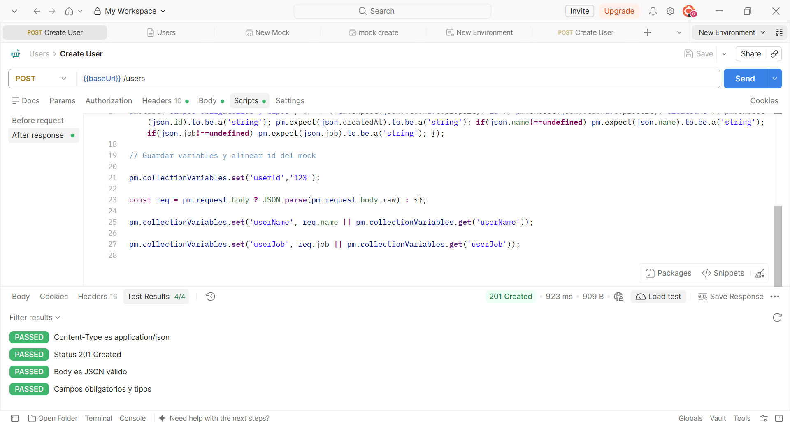
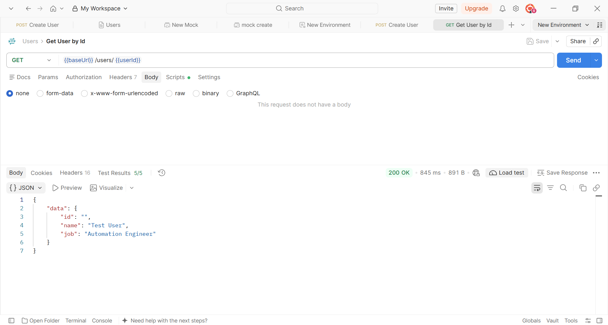
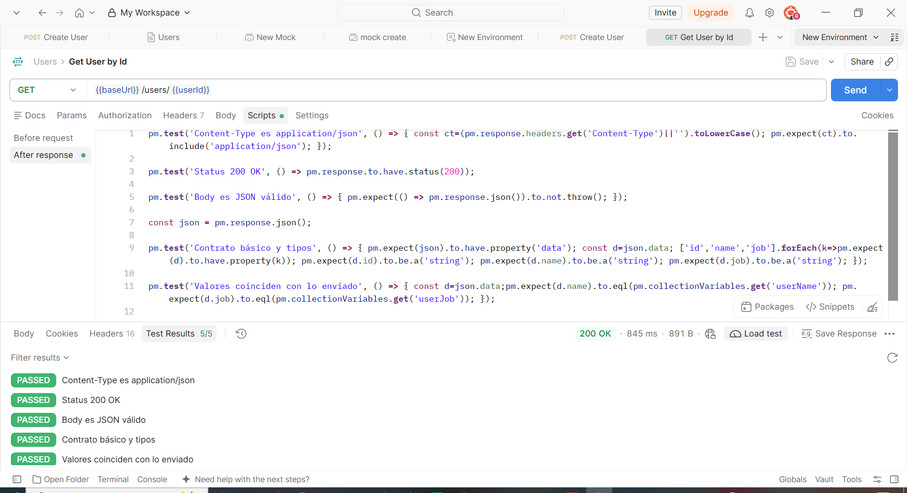

# Módulo API – Instrucciones (Postman + Mock)

## Objetivo
Cumplir el enunciado: POST /users (201) y luego GET /users/{id} (200) devolviendo el mismo name/job. Como ReqRes no persiste, usamos Mock Server de Postman.

## Archivos
- Users.postman_collection.json: colección con requests, tests y examples.

## Paso a paso
1) Importa la colección en Postman: File → Import → `TestUsers.postman_collection.json`.
2) Crea un Mock Server: New → Mock server → selecciona la colección → Create. Copia la URL (https://<id>.mock.pstmn.io).
3) Edita la colección y define la variable `baseUrl` con la URL del Mock.
4) Revisa los Examples en cada request:
   - POST /users → Example 201 con body que devuelve id "123" y createdAt. 
   - GET /users/:id → Example 200 con body que usa `{{userId}}`, `{{userName}}`, `{{userJob}}`.
5) Ejecuta en orden:
   - Create User (POST) → Status 201 Created (tests: Content-Type, contrato, guarda userId=123).
   - Get User by Id (GET) → Status 200 OK (tests: Content-Type, contrato y name/job coinciden).
6) Runner: Corre la colección (POST → GET). Deben pasar todos los tests.

## Validaciones incluidas (Tests)
- Content-Type: `application/json` en POST y GET.
- POST: `id` y `createdAt` obligatorios (string),`name` y `job` tipo string si existen.
- GET: `data.id/name/job` obligatorios (string); coinciden con los enviados.

## Evidencias
- Capturas: POST 201, GET 200, Runner con tests en verde.

CREATED USER

TESTS CREATED USER

GET USER BY ID

TESTS GET USER

